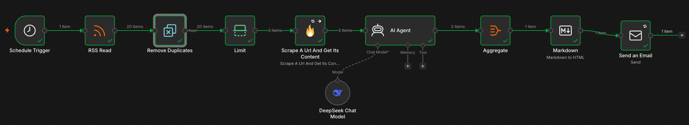
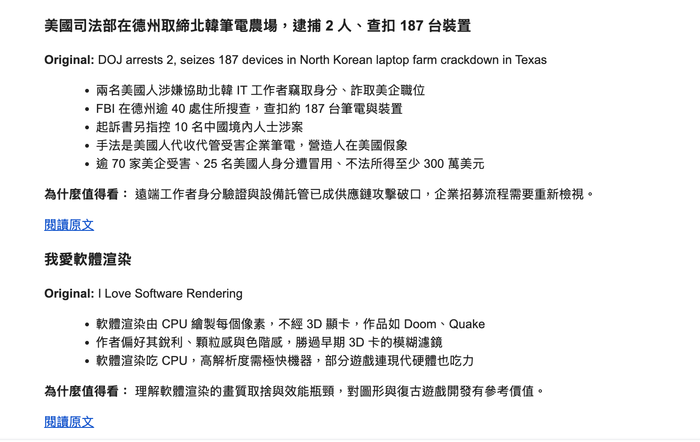

# AI Tech News Digest (n8n)

An n8n workflow that runs every 4 hours. It pulls new Hacker News stories, scrapes the full article, has an LLM write a short brief for each one in Traditional Chinese, and emails the result as a formatted digest.



## What it does

```
Schedule (every 4h)
  → RSS Read           Hacker News feed (hnrss.org)
  → Remove Duplicates  skip stories already sent in earlier runs
  → Limit              top 3 per run
  → Firecrawl          scrape the article as Markdown
  → AI Agent           DeepSeek writes title / 3 key points / why it matters
  → Aggregate          combine into one digest
  → Markdown           post-process + convert to HTML
  → Send Email         SMTP
```

Sample output:



## Design decisions

| Problem | What I did |
|---|---|
| The same story showing up in every run | `Remove Duplicates` with *Remove Items Processed in Previous Executions*, keyed on the article link |
| The LLM making up content when a page can't be scraped (paywall, video page, 401/403) | The system prompt only allows facts from the scraped text. If the body is empty, the model outputs the title and link marked "content unavailable". |
| One failed scrape stopping the whole run | Firecrawl is set to *On Error → Continue*. A failed item reaches the agent with an empty body instead of halting the workflow. |
| Losing track of which title goes with which article after a failure | The prompt looks up the title and link by position: `$('Limit').all()[$itemIndex]` (not paired-item lookup) |
| Inconsistent Markdown from the LLM (missing blank lines merged sections into one list item) | A deterministic regex step in the Markdown node adds the blank lines before rendering, instead of relying on the prompt alone |
| Flaky network / rate limits (HTTP 429, TLS resets) | *Retry On Fail* on RSS, Firecrawl and SMTP, with backoff |
| Long articles inflating token cost | Article body is truncated to 6,000 characters before it goes to the model |

## Stack

- **n8n** (self-hosted, v2.x)
- **Firecrawl** for scraping to Markdown
- **DeepSeek Chat** through the n8n AI Agent node (any OpenAI-compatible model can be swapped in)
- **SMTP** delivery (Gmail app password, or any SMTP provider)

## Run it yourself

1. Start n8n: `npx n8n` (or Docker), then open http://localhost:5678
2. **Workflows → Import from File** → choose `workflow.json`
3. Create three credentials and select each one in its node:
   - FireCrawl API key
   - DeepSeek API key (or replace the model node with OpenAI / Claude / Gemini)
   - SMTP (host, port 465, SSL on, app password)
4. In **Send an Email**, replace `sender@example.com` / `you@example.com`
5. Click **Execute** to test, then **Publish** to turn on the schedule

To change the topic, edit the RSS URL. For example, `https://hnrss.org/newest?q=AI&points=30` keeps only AI-related stories.

## Ideas for extending it

- Send to Telegram / Slack / LINE instead of email
- Store the briefs in Google Sheets or Notion as a searchable archive
- Pull from several sources (company blogs, arXiv, product changelogs)
- Score each story for relevance and send only the top N

---

**中文簡介：** 每 4 小時從 Hacker News 抓取新文章，用 Firecrawl 擷取全文，交給 DeepSeek 生成繁體中文重點摘要（標題、3 個重點、為什麼值得看），再整理成一封 HTML 信件寄出。有去重、防幻覺、失敗不中斷、自動重試和格式後處理等機制。
